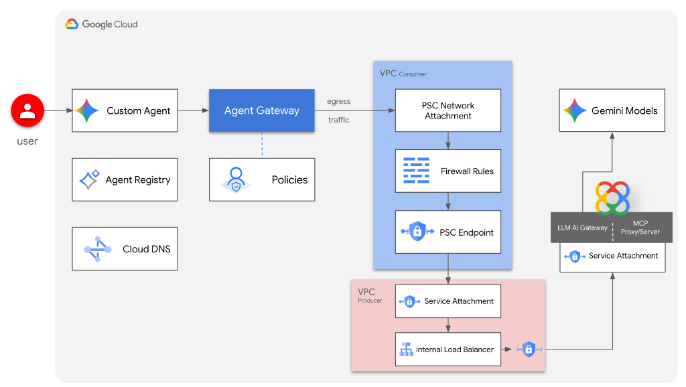
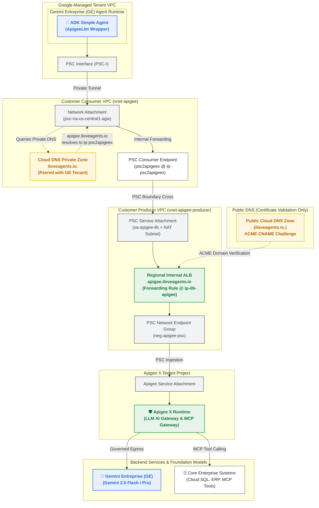
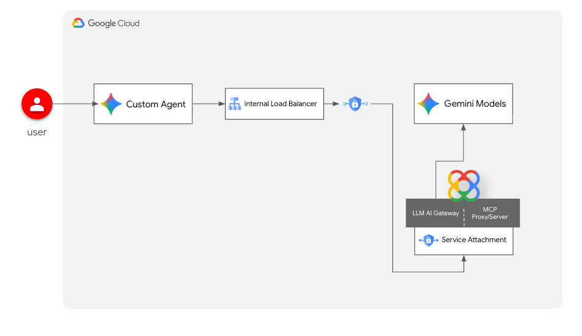

# Architecting Purely Private AI Agents: Connecting Gemini Entreprise (GE) Agent Runtime to Apigee X via Private Service Connect (PSC)

> **Author**: Google Cloud Community Contributor  
> **Topic**: Enterprise Agentic AI, API Management, Network Security  
> **Stack**: Gemini Entreprise (GE) Agent Runtime (Google ADK), Agent Gateway, Apigee X, Private Service Connect (PSC), Model Context Protocol (MCP)  
> **Source Code**: [GitHub Repository](https://github.com/joelgauci/agent-platform-apigee-llm-internal)

---

## 🌟 Executive Summary: The Enterprise AI Paradox

As enterprises race from experimental generative AI pilots into production-grade autonomous agent systems, infrastructure and security architects face a major challenge: **how do you allow autonomous AI agents to consume Foundation Models and interact with sensitive enterprise systems without exposing network endpoints to the public internet?**

In highly regulated sectors—banking, healthcare, defense, and public sector—standard public egress is a non-starter:
1. **Data Exfiltration & Privacy**: Outbound internet traffic introduces compliance liabilities (GDPR, HIPAA, PCI-DSS, SOC2).
2. **Lack of Governance & Cost Controls**: Raw, unmetered access to LLM endpoints risks denial-of-wallet spikes, lack of token quotas, and unmonitored prompt injection attacks.
3. **Tool & Backend Vulnerability**: Autonomous agents leveraging tool execution (such as the Model Context Protocol - MCP) need access to internal relational databases, ERPs, and internal microservices. Opening public firewalls for these backends is unacceptable.

In this article, we present an **end-to-end, production-tested architecture** that achieves **100% private, internal communication** between **Gemini Entreprise (GE) Agent Runtime** (powered by the Google Agent Development Kit - ADK) and **Apigee X** through **Private Service Connect (PSC)**.

By placing an internal Apigee X instance between your AI agents, foundation models, and internal tools, you unlock a dual-gateway architecture:
* **The LLM AI Gateway**: Centralized policy enforcement, Model Armor threat protection, DLP de-identification, semantic caching, token quotas, and automated model failover.
* **The Enterprise MCP Gateway**: Secure, authenticated, audited, and rate-limited access to Model Context Protocol (MCP) tools and internal enterprise backends.

### Two Architectural Approaches for Private Agent-to-Apigee Connectivity

When designing private connectivity between ADK agents on **GE Agent Runtime** and **Apigee X**, enterprise architects can choose between two topological approaches depending on their security and governance requirements:

1. **The Comprehensive Defense-in-Depth Architecture (With Agent Gateway — *Primary Focus of this Article*)**: The architecture demonstrated step-by-step in this guide incorporates **Agent Gateway** in conjunction with **Apigee X**. It provides the highest level of control, enabling cryptographic agent identity verification (**SPIFFE**), **mTLS**, **Identity-Aware Proxy (IAP)** integration, and agent-native **Semantic Governance policies** alongside Apigee's enterprise API management.
2. **The Simplified Direct Architecture (Without Agent Gateway)**: A more direct, streamlined path (**ADK Agent on Agent Runtime $\rightarrow$ Internal Load Balancer $\rightarrow$ PSC $\rightarrow$ Apigee X**) where the agent directly invokes proxies deployed on Apigee X via an Internal Load Balancer connected to Apigee X via Private Service Connect. While simpler to deploy and operate, bypassing Agent Gateway reduces the scope of native agent-edge controls (such as SPIFFE, mTLS, IAP, and Semantic Governance policies).

> [!NOTE]
> **Article Scope & Objective**: The primary goal of this article—and its companion code repository—remains to **demonstrate the feasibility and end-to-end implementation of the complete architecture incorporating Agent Gateway and Apigee X**. However, to provide a complete architectural perspective, we also detail the simplified direct approach in a dedicated section below, followed by a **Pros & Cons comparison** of both solutions.



---

## 🏗️ High-Level Architecture & Traffic Flow

The architecture operates across distinct VPC boundaries without traversing any public IP space, Cloud NAT, or public internet routing:



> [!IMPORTANT]
> **Domain Ownership & Example Hostname (`apigee.iloveagents.io`)**
> Throughout this article and the reference implementation, `apigee.iloveagents.io` is used as an illustrative domain example. In your own deployment, **you must bring and own your own custom domain** (e.g., `ai.yourcompany.com`).
> 
> **Why is owning your public domain mandatory?**
> 1. **Strict CA Validation**: Workloads running inside GE Agent Runtime operate in managed container runtimes where standard client runtimes (e.g., Python `requests`, `urllib3`, `httpx`, gRPC) strictly validate server certificates against official public root Certificate Authorities (such as the Mozilla CA bundle). Self-signed certificates will fail immediately with `ssl.SSLCertVerificationError: [SSL: CERTIFICATE_VERIFY_FAILED]`.
> 2. **Automated ACME Validation**: To provision a valid, publicly trusted certificate on an internal load balancer via Google Cloud Certificate Manager, Google requires domain control verification through an ACME CNAME challenge.
> 3. **The Split-Horizon DNS Advantage**: You publish the ACME CNAME record in your **public DNS** once to validate ownership and issue the Google-managed certificate. Meanwhile, runtime agent requests resolve via **private Cloud DNS** inside your Consumer VPC directly to the internal PSC endpoint (`ip-psc2apigeex`). No application traffic ever touches the public internet.

### Detailed Network Hop Sequence
1. **Agent Egress**: The AI agent executing on GE Agent Runtime initiates an outbound HTTPS call to `https://apigee.iloveagents.io/v1/llm-ai-gateway`.
2. **Private Split-Horizon DNS Resolution**: The GE Agent Runtime queries the peered Cloud DNS private zone (`iloveagents.io.`) hosted in the Customer Consumer VPC (`vnet-apigee`), resolving the domain `apigee.iloveagents.io` directly to `ip-psc2apigeex` (the internal IP address allocated to the Consumer PSC endpoint).
3. **PSC-Interface Transit**: Traffic leaves the Agent Runtime container via a dedicated Private Service Connect Interface (PSC-I), passing directly into the Consumer VPC's **Network Attachment** (`psc-na-us-central1-agw`).
4. **Consumer PSC Endpoint Forwarding**: Inside the Consumer VPC, traffic hits the PSC consumer endpoint forwarding rule (`psc2apigeex`, bound to `ip-psc2apigeex`), which tunnels across the cross-VPC boundary to the **PSC Service Attachment** (`sa-apigee-ilb`) in the Producer VPC.
5. **Producer Internal Load Balancing & TLS Termination**: The Service Attachment translates traffic through its dedicated PSC NAT subnet and delivers it to the regional Internal Application Load Balancer (`forwarding-rule-apigee-ilb`, bound to `ip-ilb-apigee`). The ILB terminates TLS using a trusted Google-managed certificate provisioned via Certificate Manager for `apigee.iloveagents.io`.
6. **Apigee Ingestion via PSC NEG**: The ILB forwards the payload to an Apigee Private Service Connect Network Endpoint Group (`neg-apigee-psc`), which routes through Apigee's Service Attachment into the Apigee X runtime plane inside Google's managed producer VPC.
7. **Policy Execution**: Apigee enforces authentication (`x-apikey`), token rate limits, Model Armor threat detection, and DLP masking.
8. **Downstream Dispatch**:
   - **For LLM Calls**: Apigee invokes the upstream Gemini Entreprise (GE) foundation model endpoint over Google's private network backbone.
   - **For MCP Tool Calls**: Apigee forwards the JSON-RPC tool invocation to internal backend microservices or databases.


### 💰 FinOps Advantage: Zero Network Egress via Regional Co-Location

In production agentic systems, data payloads are substantial: multi-turn conversation histories, extensive RAG context windows, and recursive tool calls can easily generate gigabytes of traffic per hour.

From a cloud financial operations (FinOps) standpoint, this architecture provides a major cost efficiency:

> **The Regional Egress Rule**: **Network egress costs are strictly ZERO ($0.00/GB) when all components remain within the same Google Cloud region.**

Why this matters for enterprise budgets:
1. **Zero Internet Egress**: Because communication between the GE Agent Runtime, Apigee X, foundation models, and internal MCP backends flows entirely over Private Service Connect (PSC) and Google’s software-defined network, **public internet egress fees ($0.08–$0.12+/GB) are completely eliminated**.
2. **Zero Inter-Region Egress**: By co-locating the Agent Runtime, Network Attachment, VPC networks, Internal Load Balancer, Apigee X instance, and Vertex AI models in the same GCP region (e.g., `us-central1`), **inter-region data transfer fees ($0.01–$0.05/GB) are zero**.
3. **Zero Inter-Zone Egress for PSC**: Google Cloud specifically **waives inter-zone data transfer charges** for traffic routed to and from Private Service Connect endpoints. Cross-zone resilience inside the region incurs no network bandwidth penalty.

> [!NOTE]
> **Network Egress vs. Data Processing**: While *network egress bandwidth* is 100% free within the region, standard and predictable processing fees still apply: PSC data processing (~$0.01/GiB) and Internal Application Load Balancer processing (~$0.008/GB). By eliminating unpredictable egress multipliers, enterprise FinOps teams gain fixed, deterministic network cost models even during high agent activity spikes.

---

## 🛡️ The Two Core Pillars of Enterprise AI Mediation

### Pillar 1: The AI Gateway Pattern for Foundation Models

Connecting autonomous agents directly to raw model APIs bypasses the standard controls established by enterprise cybersecurity and FinOps teams. Mediating all agent-to-model traffic through Apigee X delivers critical enterprise capabilities:

| Enterprise Concern | Apigee LLM AI Gateway Capability | Impact |
| :--- | :--- | :--- |
| **Denial-of-Wallet & Budget Overruns** | **Token-Aware Quotas & Rate Limits** | Enforce strict per-minute and per-month token consumption budgets per agent or line of business. |
| **Prompt Injection & Jailbreaking** | **Google Model Armor Threat Defense** | Real-time sanitization of prompts and system instruction integrity checks before hitting the LLM. |
| **PII & Sensitive Data Leakage** | **Cloud Sensitive Data Protection (DLP)** | Automatic detection and cryptographic redaction/masking of credit card numbers, SSNs, and healthcare data. |
| **Redundant Latency & Cost** | **Semantic Vector Caching** | Cache frequent or semantically equivalent questions in Vector Search; return cached responses in <50ms at zero token cost. |
| **Model Outages & Rate Limits** | **Intelligent Multi-Model Failover** | Automatically reroute traffic to fallback models (e.g. Gemini 2.5 Flash if Gemini 1.5 Pro throws a 429 or 503). |

### Pillar 2: The Enterprise MCP (Model Context Protocol) Gateway

The **Model Context Protocol (MCP)**, open-sourced by Anthropic, has emerged as the standard protocol for providing AI agents with context and execution tools (reading database schemas, querying ERP records, triggering workflows).

However, running MCP servers directly in an unmanaged network presents severe operational and security risks:
* **Unauthenticated Tool Invocations**: Agents might invoke privileged tools without granular authorization.
* **Lack of Visibility**: Security teams cannot inspect the parameters passed to tool functions.
* **Backend Overload**: Autonomous agent reasoning loops can issue rapid recursive tool calls, taking down internal databases.

#### How Apigee Solves Enterprise MCP:
1. **MCP Endpoint Standardization**: Expose internal MCP servers as managed Apigee API proxies (e.g., `https://apigee.iloveagents.io/mcp/v1/customer-crm`).
2. **Zero-Trust Identity**: Require Workload Identity or OAuth 2.0 mutual tokens from the agent before permitting tool execution.
3. **Payload & Parameter Inspection**: Validate that tool arguments conform strictly to JSON Schema definitions using Apigee validation policies.
4. **Audit Logging & Tracing**: Every tool invocation, parameter set, execution duration, and response payload is captured in Cloud Logging and Cloud Trace.
5. **Backpressure & Concurrency Limits**: Protect delicate legacy backend systems from agentic query bursts via Spike Arrest and Concurrent Rate Limiting policies.

---

## 🤝 Best of Both Worlds: Agent Gateway Meets Apigee X

A frequent design question among enterprise architects is: **"Should we enforce AI policies on Agent Gateway or on Apigee X?"**

The short answer is: **You get the best of both worlds by combining them.**

Rather than choosing one over the other, enterprise architects can implement a **layered defense-in-depth model** where each component excels at what it was designed for.

### 1. Flexible Placement for Model Armor
**Google Model Armor** provides real-time detection and sanitization against adversarial attacks, system prompt leakage, and jailbreaks. In this architecture, Model Armor policies can be flexibly evaluated at either tier—or both:
* **On Agent Gateway**: Sanitizing prompts immediately as they leave the agent runtime prevents rogue instructions from even entering your network. Likewise, sanitizing LLM or tool responses before feeding them back into agent reasoning loops shields the agent against indirect prompt injection.
* **On Apigee X**: Running Model Armor on Apigee centralizes policy administration across your entire organization. Any application—whether a GE agent, an internal web portal, or a customer-facing chatbot—benefits from a single, auditable security perimeter.

### 2. Semantic Governance Policies on Agent Gateway
**Agent Gateway** is purpose-built with deep awareness of agentic semantics. It supports **Semantic Governance Policies** that evaluate:
* The broader multi-turn agent conversation context.
* Agent intent boundaries (e.g., verifying if the agent is staying strictly within its designated functional role).
* Real-time semantic compliance rules tailored to specific agent workflows.

### 3. Enterprise-Grade API Management on Apigee X
While Agent Gateway manages agent-native semantics, **Apigee X** brings enterprise maturity for operational, financial, and business controls:
* **Token Quota Budgets**: Enforce strict token consumption tiers across different cost centers and teams, avoiding surprise cloud bills.
* **Sensitive Data Protection (Cloud DLP)**: Deep inspection to mask or encrypt sensitive PII (credit cards, IBANs, medical records) in prompts and responses.
* **Semantic Vector Caching**: Intercept repetitive queries using Vector Search to deliver answers under 50ms at zero token cost.
* **Intelligent Routing & Failover**: Route seamlessly between frontier models (Gemini 2.5 Pro) and lightweight models (Gemini 2.5 Flash / Gemma on Cloud Run), with automatic circuit-breaking.
* **Enterprise MCP Gateway**: Mediate all Model Context Protocol (MCP) tool invocations, providing rate-limiting, OAuth2 authentication, and exhaustive auditing for internal backends.

By coupling the **semantic, agent-native intelligence of Agent Gateway** with the **hardened API governance and enterprise connectivity of Apigee X**, organizations eliminate the trade-off between AI agility and enterprise security.

---

## 💡 Alternative Pattern: The Simplified Direct Architecture (Without Agent Gateway)

While the reference architecture presented in this article combines **Agent Gateway** and **Apigee X** for maximum defense-in-depth, some organizations may look for a lighter, more direct integration path that does not involve the **Agent Gateway** component.



### How the Simplified Solution Works
In this simplified topology, an autonomous agent built with the **Google Agent Development Kit (ADK)** and deployed on **GE Agent Runtime** communicates directly with API proxies hosted on **Apigee X**:

1. **Direct Agent-to-ILB Connectivity**: The ADK agent running on Agent Runtime connects out to the customer VPC network (via Private Service Connect Interface) and targets a regional **Internal Application Load Balancer (ILB)** directly, without passing through an intermediate Agent Gateway layer.
2. **PSC Bridge to Apigee X**: The Internal Load Balancer is wired directly to the **Apigee X** platform using a **Private Service Connect (PSC) Network Endpoint Group (NEG)** pointing to the Apigee X Service Attachment.
3. **Centralized Proxy Execution on Apigee X**: The ADK agent references the internal hostname of the ILB to invoke LLM proxies and MCP tool proxies exposed on Apigee X. All traffic remains 100% private within the Google Cloud internal network.

### What Changes Without Agent Gateway?
By removing **Agent Gateway** from the data path, the network and operational footprint is reduced, as all policies are consolidated exclusively on **Apigee X** (such as API key or OAuth verification, token quotas, Cloud DLP, and Apigee-level Model Armor).

However, bypassing Agent Gateway means relinquishing specialized **agent-edge security and governance controls** that Agent Gateway natively provides:
* **No Native SPIFFE Identity Enforcement at the Agent Edge**: You lose out-of-the-box cryptographic workload identity attestation via SPIFFE IDs managed by Agent Gateway.
* **Simplified Transport & Access Controls (mTLS & IAP)**: You no longer benefit from Agent Gateway's integrated mutual TLS (mTLS) termination and Identity-Aware Proxy (IAP) integration tailored for agent-to-gateway zero-trust handshakes, requiring any transport-level authentication to be manually configured and maintained on the ILB and Apigee X.
* **Absence of Semantic Governance Policies**: Unlike Apigee X—which excels at stateless and token-aware API mediation—Agent Gateway is specifically engineered to evaluate **Semantic Governance policies** (such as multi-turn conversation drift, agent role adherence, and intent boundary enforcement). Without Agent Gateway, these fine-grained semantic controls at the agent egress point are unavailable.

---

## ⚖️ Architectural Comparison: Pros & Cons of Both Approaches

To help enterprise architects select the right topology for their maturity level and regulatory posture, here is a detailed breakdown of the advantages and trade-offs of each solution.

### Solution 1: Full Defense-in-Depth Architecture (With Agent Gateway + Apigee X)
*Path: `ADK Agent (Agent Runtime) -> Agent Gateway -> ILB (PSC) -> Apigee X`*

**✅ Pros:**
* **Comprehensive Zero-Trust Security**: Native support for **SPIFFE** cryptographic workload identities, automated **mTLS**, and **Identity-Aware Proxy (IAP)** controls at the agent boundary.
* **Semantic Governance Policies**: Enables deep, context-aware inspection of agent intent, multi-turn conversation compliance, and functional role boundaries before requests ever reach downstream API gateways.
* **Dual-Layer Defense-in-Depth**: Allows **Model Armor** and security guardrails to be enforced both at the immediate agent egress (Agent Gateway) and at the enterprise API perimeter (Apigee X).
* **Clear Separation of Duties**: AI/Agent platform teams can manage agent-specific semantic rules on Agent Gateway, while central API & Security teams enforce enterprise-wide quotas, DLP, caching, and backend routing on Apigee X.

**❌ Cons:**
* **Higher Architectural & Operational Complexity**: Introduces an additional managed component and network hop to provision, configure, and monitor.
* **Multi-Tier Policy Management**: Governance rules are distributed across two control planes (Agent Gateway for agent semantics and identity; Apigee X for API mediation, FinOps quotas, and MCP backends), requiring coordinated governance across teams.

---

### Solution 2: Simplified Direct Architecture (Without Agent Gateway)
*Path: `ADK Agent (Agent Runtime) -> ILB (PSC) -> Apigee X`*

**✅ Pros:**
* **Architectural Simplicity**: Fewer infrastructure components to deploy and maintain, resulting in a shorter path from the ADK agent to the Apigee X proxies.
* **Single Control Plane for Policies**: All API management, LLM routing, rate limiting, and security policies are centralized in a single location—**Apigee X**—which simplifies day-2 operations for teams already standardized on Apigee.
* **Lower Hop Latency & Reduced Footprint**: Eliminating the intermediate gateway layer slightly reduces network hop count and infrastructure overhead while preserving 100% private connectivity via PSC.

**❌ Cons:**
* **Reduced Security & Identity Controls**: Loss of turnkey **SPIFFE** identity attestation, integrated **mTLS**, and **IAP** enforcement that Agent Gateway provides out of the box.
* **No Semantic Governance Policies**: Inability to enforce native agent-aware semantic guardrails (such as intent boundary validation and multi-turn behavioral governance) at the agent runtime egress.
* **Coarser Perimeter Defense**: Relies on a single mediation tier (Apigee X) rather than a layered defense-in-depth architecture, meaning rogue or compromised agent prompts travel directly to the enterprise API gateway before being inspected.

### Summary Comparison Matrix

| Dimension | Solution 1: With Agent Gateway + Apigee X *(Main Focus)* | Solution 2: Simplified Direct (`Agent -> ILB (PSC) -> Apigee X`) |
| :--- | :--- | :--- |
| **Private Connectivity (PSC)** | 100% Private (Zero public internet exposure) | 100% Private (Zero public internet exposure) |
| **API & LLM Mediation (Quotas, DLP, Caching, Failover)** | Handled by Apigee X | Handled by Apigee X |
| **Semantic Governance Policies** | **Yes** (Native on Agent Gateway) | **No** |
| **SPIFFE, mTLS & IAP Controls** | **Turnkey / Native** via Agent Gateway | **Limited** (Requires custom manual setup on ILB/Apigee) |
| **Deployment Complexity** | Higher (Dual-gateway defense-in-depth) | Lower (Direct ILB to Apigee X via PSC) |
| **Best Suited For** | Regulated enterprises requiring strict zero-trust identity (SPIFFE/mTLS) and semantic agent governance | Rapid adoption, internal pilots, or environments where standard Apigee X API controls are sufficient |

---

## 🔬 Under the Hood: The Four Technical Hurdles Solved

### 1. Private Service Connect Interface (PSC-I) & Network Attachments
Unlike standard Gemini Entreprise deployments that route outbound traffic through Google Cloud default internet gateways, GE Agent Runtime supports **Private Service Connect Interfaces**.
By binding a **Network Attachment** (`compute.networkAttachments`) in the Consumer VPC to the Agent Runtime deployment, the tenant container receives a virtual NIC plugged directly into your internal VPC subnet:

```python
psc_config = aiplatform.PscInterfaceConfig(
    network_attachment=f"projects/{project}/regions/{region}/networkAttachments/psc-na-{region}-agw",
    dns_peering_configs=[
        aiplatform.DnsPeeringConfig(
            domain="iloveagents.io.",
            target_project=project,
            target_network="vnet-apigee"
        )
    ]
)
```

### 2. Dual-Sided Split-Horizon DNS & Multi-VPC PSC Resolution
Because the Agent Runtime lives in a Google-managed tenant environment, it cannot natively query private Cloud DNS zones configured in your private VPC. Furthermore, Google Cloud Private Service Connect strictly enforces that **a Service Attachment and a PSC Endpoint targeting it cannot reside in the same VPC network**.

To satisfy both requirements:
* **Multi-VPC Architecture**: The infrastructure is cleanly partitioned into a Consumer VPC (`vnet-apigee`) hosting the Network Attachment and Consumer PSC Endpoint (`psc2apigeex`), and a Producer VPC (`vnet-apigee-producer`) hosting the regional ILB, proxy subnet, PSC NAT subnet, and Service Attachment (`sa-apigee-ilb`).
* **DNS Split-Horizon**:
  - **Public DNS (`pub-zone-iloveagents`)**: Used exclusively for Certificate Manager's ACME CNAME challenge to prove domain ownership for `apigee.iloveagents.io`.
  - **Private DNS (`priv-zone-run`)**: A Private DNS Zone (`iloveagents.io.`) created in the Consumer VPC maps `apigee.iloveagents.io` to the internal Consumer PSC Endpoint address resource (`ip-psc2apigeex`).
* During agent deployment, `dns_peering_configs` informs GE to peer its internal resolution engine for `iloveagents.io.` directly to `vnet-apigee`.
* When the agent resolves `apigee.iloveagents.io`, it receives the internal address `ip-psc2apigeex` with zero DNS leakage and zero public internet exposure.

### 3. Strict TLS Termination on Private Endpoints & Public CA Trust
Workloads running inside GE Agent Runtime containers strictly reject self-signed certificates. Standard client libraries (e.g., Python `urllib3`, `requests`, `httpx`, gRPC) validate certificates against the public root CA store.
To guarantee enterprise-grade security without compromising trust:
* The Regional Internal Application Load Balancer terminates TLS on port 443.
* A Google-managed certificate is provisioned via Certificate Manager using DNS authorization on your owned domain, presenting a Subject Alternative Name (SAN) matching `apigee.iloveagents.io`.
* The Apigee client in the ADK agent establishes a trusted TLS handshake using the private domain name, ensuring encryption in transit across the entire software-defined network.

### 4. OpenTelemetry Distributed Tracing & Observability
By leveraging GE Agent Runtime's native OpenTelemetry support, the agent automatically exports traces and spans to **Google Cloud Trace** and logs to **Cloud Logging**:

```python
env_vars = [
    aiplatform.EnvVar(name="GOOGLE_CLOUD_AGENT_ENGINE_ENABLE_TELEMETRY", value="true"),
    aiplatform.EnvVar(name="OTEL_SEMCONV_STABILITY_OPT_IN", value="gen_ai_latest_experimental"),
    aiplatform.EnvVar(name="OTEL_INSTRUMENTATION_GENAI_CAPTURE_MESSAGE_CONTENT", value="EVENT_ONLY"),
]
```

This allows engineering teams to navigate to the **Traces** tab in the Google Cloud Console and visualize:
* Total turn-around time per agent query.
* Internal DNS resolution latency.
* Time spent in Apigee policy execution vs. foundation model generation.
* Exact prompt and response payloads (captured for anomaly analysis).

---

## 💻 Step-by-Step Implementation Guide

Here is how the solution is assembled using the scripts and code from the reference repository.

### Step 1: Network & Infrastructure Provisioning
Run Phase 2 (`02_network_setup.sh`) to create the Consumer and Producer VPC networks, subnets, firewall rules, and the Network Attachment:

```bash
# 02_network_setup.sh
# 1. Create Consumer VPC and Producer VPC networks
gcloud compute networks create vnet-apigee --subnet-mode=custom
gcloud compute networks create vnet-apigee-producer --subnet-mode=custom

# 2. Subnets in Consumer VPC
# Primary Subnet: hosts the Network Attachment and Consumer PSC Endpoint (ip-psc2apigeex)
gcloud compute networks subnets create subnet-us-central1-agw \
  --network=vnet-apigee \
  --region=us-central1 \
  --range=${SUBNET_AGW_RANGE} \
  --enable-private-ip-google-access

# 3. Subnets in Producer VPC
# Primary Subnet: hosts the regional Internal ALB (ip-ilb-apigee)
gcloud compute networks subnets create subnet-us-central1-producer-ilb \
  --network=vnet-apigee-producer \
  --region=us-central1 \
  --range=${SUBNET_ILB_RANGE} \
  --enable-private-ip-google-access

# Proxy-Only Subnet: required by regional Envoy Internal ALB
gcloud compute networks subnets create subnet-us-central1-proxy \
  --network=vnet-apigee-producer \
  --region=us-central1 \
  --range=${SUBNET_PROXY_RANGE} \
  --purpose=REGIONAL_MANAGED_PROXY \
  --role=ACTIVE

# PSC NAT Subnet: provides NAT pool for Service Attachment traversal
gcloud compute networks subnets create subnet-us-central1-psc-nat \
  --network=vnet-apigee-producer \
  --region=us-central1 \
  --range=${SUBNET_PSC_NAT_RANGE} \
  --purpose=PRIVATE_SERVICE_CONNECT

# 4. Create Network Attachment in Consumer VPC for GE Agent Runtime PSC-I
gcloud compute network-attachments create psc-na-us-central1-agw \
  --region=us-central1 \
  --subnets=subnet-us-central1-agw \
  --connection-preference=ACCEPT_AUTOMATIC
```

### Step 2: Internal ALB & Apigee PSC NEG Integration (Producer VPC)
Deploy the regional Internal Application Load Balancer in the Producer VPC and connect its backend service to the Apigee X Service Attachment via a PSC NEG:

```bash
# 1. Connect ILB Backend to Apigee X via PSC NEG
gcloud compute network-endpoint-groups create neg-apigee-psc \
  --region=us-central1 \
  --network-endpoint-type=PRIVATE_SERVICE_CONNECT \
  --psc-target-service=${APIGEE_SVC_ATTACHMENT} \
  --network=vnet-apigee-producer \
  --subnet=subnet-us-central1-producer-ilb

# 2. Regional HTTPS Backend Service
gcloud compute backend-services create backend-apigee-ilb \
  --load-balancing-scheme=INTERNAL_MANAGED \
  --protocol=HTTPS \
  --region=us-central1

gcloud compute backend-services add-backend backend-apigee-ilb \
  --network-endpoint-group=neg-apigee-psc \
  --network-endpoint-group-region=us-central1 \
  --region=us-central1

# 3. Certificate Manager DNS Authorization & Managed Certificate
# NOTE: Requires ownership of a public DNS domain (e.g. iloveagents.io) to complete the ACME challenge
gcloud certificate-manager dns-authorizations create auth-apigee-iloveagents \
  --domain="apigee.iloveagents.io" \
  --location=us-central1

export CNAME_NAME=$(gcloud certificate-manager dns-authorizations describe auth-apigee-iloveagents \
  --location=us-central1 --format="value(dnsResourceRecord.name)")
export CNAME_DATA=$(gcloud certificate-manager dns-authorizations describe auth-apigee-iloveagents \
  --location=us-central1 --format="value(dnsResourceRecord.data)")

# Publish ACME challenge CNAME record in Public Cloud DNS
gcloud dns record-sets create "${CNAME_NAME}" \
  --zone=pub-zone-iloveagents \
  --type=CNAME \
  --ttl=300 \
  --rrdatas="${CNAME_DATA}"

# Provision Google-managed certificate
gcloud certificate-manager certificates create cert-apigee-ilb \
  --domains="apigee.iloveagents.io" \
  --dns-authorizations=auth-apigee-iloveagents \
  --location=us-central1

# 4. Regional URL Map and Target HTTPS Proxy
gcloud compute url-maps create urlmap-apigee-ilb \
  --default-service=backend-apigee-ilb \
  --region=us-central1

gcloud compute target-https-proxies create target-proxy-apigee-ilb \
  --url-map=urlmap-apigee-ilb \
  --certificate-manager-certificates=cert-apigee-ilb \
  --region=us-central1

# 5. Reserve Static Internal Address for Producer ILB (ip-ilb-apigee)
# ip-ilb-apigee designates the reserved private IP address resource for the producer ILB
gcloud compute addresses create ip-ilb-apigee \
  --region=us-central1 \
  --subnet=subnet-us-central1-producer-ilb

# 6. Configure Forwarding Rule for Producer ILB on Port 443
gcloud compute forwarding-rules create forwarding-rule-apigee-ilb \
  --region=us-central1 \
  --load-balancing-scheme=INTERNAL_MANAGED \
  --network=vnet-apigee-producer \
  --subnet=subnet-us-central1-producer-ilb \
  --address=ip-ilb-apigee \
  --ports=443 \
  --target-https-proxy=target-proxy-apigee-ilb \
  --target-https-proxy-region=us-central1
```

### Step 3: PSC Service Attachment, Consumer PSC Endpoint & Split DNS
Publish the Producer ILB via a Service Attachment, establish the Consumer PSC Endpoint, and map private DNS directly to the Consumer PSC endpoint address:

```bash
# 1. Create PSC Service Attachment exposing the ILB
gcloud compute service-attachments create sa-apigee-ilb \
  --region=us-central1 \
  --producer-forwarding-rule=forwarding-rule-apigee-ilb \
  --connection-preference=ACCEPT_AUTOMATIC \
  --nat-subnets=subnet-us-central1-psc-nat

export ILB_SA_URI=$(gcloud compute service-attachments describe sa-apigee-ilb \
  --region=us-central1 \
  --format="value(selfLink.scope(v1))")

# 2. Reserve Static Internal Address for Consumer PSC Endpoint (ip-psc2apigeex)
# ip-psc2apigeex designates the reserved private IP address resource for the PSC endpoint in Consumer VPC
gcloud compute addresses create ip-psc2apigeex \
  --region=us-central1 \
  --subnet=subnet-us-central1-agw

# 3. Create Consumer PSC Forwarding Rule / Endpoint pointing to Producer Service Attachment
gcloud compute forwarding-rules create psc2apigeex \
  --region=us-central1 \
  --network=vnet-apigee \
  --address=ip-psc2apigeex \
  --target-service-attachment=${ILB_SA_URI}

# 4. Create Private Cloud DNS Zone in Consumer VPC
gcloud dns managed-zones create priv-zone-run \
  --description="Private zone for internal Apigee gateway" \
  --dns-name="iloveagents.io." \
  --visibility=private \
  --networks=vnet-apigee

# 5. Map apigee.iloveagents.io directly to the Consumer PSC Endpoint IP
gcloud dns record-sets create apigee.iloveagents.io \
  --zone=priv-zone-run \
  --type=A \
  --ttl=300 \
  --rrdatas=$(gcloud compute addresses describe ip-psc2apigeex --region=us-central1 --format="value(address)")
```

### Step 4: ADK Agent Implementation (`agent.py`)
Using Google ADK, we implement the agent using the `ApigeeLlm` custom model wrapper:

```python
# agent_apigee/agent.py
import os
import logging
from google.adk import Runner
from google.adk.agents import Agent
from google.adk.models.apigee_llm import ApigeeLlm
from google.adk.plugins import LoggingPlugin
from google.adk.sessions import InMemorySessionService
from google.genai import types

class ApigeeAgentApp:
    def __init__(self, apigee_hostname=None, apigee_llm=None, apikey=None, model_name=None):
        self.apigee_hostname = apigee_hostname or os.getenv("APIGEE_HOSTNAME", "apigee.iloveagents.io")
        self.apigee_llm = apigee_llm or os.getenv("APIGEE_LLM", "/v1/llm-ai-gateway")
        self.apikey = apikey or os.getenv("APIGEE_APIKEY")
        # Note: 'apigee/vertex_ai/...' is the required technical provider key for the ADK ApigeeLlm wrapper
        self.model_name = model_name or os.getenv("MODEL_NAME", "apigee/vertex_ai/gemini-2.5-flash")
        self._runner = None

    def set_up(self):
        custom_headers = {"x-apikey": self.apikey}
        model = ApigeeLlm(
            model=self.model_name,
            proxy_url=f"https://{self.apigee_hostname}{self.apigee_llm}",
            custom_headers=custom_headers
        )
        agent = Agent(
            name="simple_apigee_agent",
            model=model,
            instruction="You are a secure, helpful enterprise assistant powered by Apigee LLM Gateway."
        )
        self._session_service = InMemorySessionService()
        self._runner = Runner(
            agent=agent,
            app_name="simple_apigee_agent",
            session_service=self._session_service,
            plugins=[LoggingPlugin()]
        )

    async def query(self, prompt: str) -> str:
        if not self._runner:
            self.set_up()
        session = await self._session_service.create_session(
            app_name="simple_apigee_agent", user_id="user"
        )
        content = types.Content(role="user", parts=[types.Part(text=prompt)])
        response_text = ""
        async for event in self._runner.run_async(session_id=session.id, user_id="user", new_message=content):
            if hasattr(event, "content") and event.content and hasattr(event.content, "parts"):
                for part in event.content.parts:
                    if hasattr(part, "text") and part.text:
                        response_text += part.text
        return response_text

root_agent = ApigeeAgentApp()
```

### Step 5: Deploying with Programmatic PSC-I Configuration
We deploy the agent to GE Agent Runtime using the Python SDK with `PscInterfaceConfig` baked directly into the `ReasoningEngineSpec`:

```python
# agent_apigee/deploy_agent.py
from google.cloud import aiplatform_v1beta1 as aiplatform
import vertexai.reasoning_engines._reasoning_engines as _re_internal

# 1. Package artifacts
_re_internal._prepare(
    reasoning_engine=root_agent,
    requirements=[
        "google-adk>=1.18.0",
        "google-cloud-aiplatform>=1.70.0",
        "google-genai",
        "python-dotenv",
        "cloudpickle",
        "requests"
    ],
    project=args.project,
    location=args.region,
    staging_bucket=f"gs://{args.staging_bucket}",
    extra_packages=[os.path.join(agent_dir, "agent.py")]
)

# 2. Define PSC Interface and DNS Peering
psc_config = aiplatform.PscInterfaceConfig(
    network_attachment=f"projects/{args.project}/regions/{args.region}/networkAttachments/psc-na-{args.region}-agw",
    dns_peering_configs=[
        aiplatform.DnsPeeringConfig(
            domain="iloveagents.io.",
            target_project=args.project,
            target_network="vnet-apigee"
        )
    ]
)

# 3. Create Deployment Specification with Telemetry
deployment_spec = aiplatform.ReasoningEngineSpec.DeploymentSpec(
    psc_interface_config=psc_config,
    env=[
        aiplatform.EnvVar(name="GOOGLE_CLOUD_AGENT_ENGINE_ENABLE_TELEMETRY", value="true"),
        aiplatform.EnvVar(name="OTEL_SEMCONV_STABILITY_OPT_IN", value="gen_ai_latest_experimental"),
        aiplatform.EnvVar(name="OTEL_INSTRUMENTATION_GENAI_CAPTURE_MESSAGE_CONTENT", value="EVENT_ONLY"),
    ]
)

# 4. Submit to Gemini Entreprise (GE) Agent Runtime
client = aiplatform.ReasoningEngineServiceClient(client_options={"api_endpoint": f"{args.region}-aiplatform.googleapis.com"})
operation = client.create_reasoning_engine(
    parent=f"projects/{args.project}/locations/{args.region}",
    reasoning_engine=aiplatform.ReasoningEngine(
        display_name="simple-agent",
        spec=aiplatform.ReasoningEngineSpec(
            package_spec=package_spec,
            deployment_spec=deployment_spec,
            identity_type=aiplatform.ReasoningEngineSpec.IdentityType.AGENT_IDENTITY
        )
    )
)
result = operation.result()
print(f"Deployed successfully: {result.name}")
```

### Step 6: Querying the Private Agent
You can query the deployed agent via the GE REST API or gcloud CLI:

```bash
# 06_query_agent.sh
RE_ENGINE_ID="1062802782815256576"
REGION="us-central1"
PROJ_ID="agent-platform-exp"

curl -s -X POST \
  "https://${REGION}-aiplatform.googleapis.com/v1/projects/${PROJ_ID}/locations/${REGION}/reasoningEngines/${RE_ENGINE_ID}:query" \
  -H "Authorization: Bearer $(gcloud auth application-default print-access-token)" \
  -H "Content-Type: application/json" \
  -d '{
    "classMethod": "query",
    "input": {
      "prompt": "Hello! Explain what makes your network architecture secure."
    }
  }' | jq -r '.output'
```

---

## 🔒 Security Best Practices Checklist

When bringing this pattern into production environments, follow these core security tenets:

1. **Leverage AGENT_IDENTITY**:
   Always specify `identity_type=AGENT_IDENTITY`. This equips the deployed agent container with a unique, cryptographically verifiable Google service account identity (`agents.global.org-*.system.id.goog/...`), eliminating the need to store long-lived service account keys inside code artifacts.
2. **Rotate Apigee API Keys with Secret Manager**:
   Store the Apigee API key or OAuth credentials in **Google Secret Manager**. Configure Secret Manager access directly to the Agent Platform Service Agent and inject credentials securely via environment variable references (`secret_ref`).
3. **Enforce Mutual TLS (mTLS) for High-Security Zones**:
   For government, financial, or healthcare use cases, configure the Internal Application Load Balancer with Client Certificate Validation (mTLS) to cryptographically verify the agent identity before traffic is accepted.
4. **Segregate Network Attachments by Security Tier**:
   Use distinct Network Attachments for development, staging, and production agent pools, ensuring that testing agents cannot inadvertently route traffic to production Apigee environments.

---

## 🎯 Summary & Key Takeaways

1. **Zero Public Internet Exposure**: Combining GE Agent Runtime's PSC-I with Apigee X's Service Attachment establishes a completely private communication channel across tenant boundaries.
2. **DNS Split-Horizon with Named Endpoints**: Public DNS validates domain ownership for Google Certificate Manager, while Private DNS resolves `apigee.iloveagents.io` strictly to the Consumer PSC endpoint address (`ip-psc2apigeex`), avoiding all public routing.
3. **Best of Both Worlds (Agent Gateway + Apigee X)**: Enforce agent-aware Semantic Governance and low-latency Model Armor at the Agent Gateway edge, while leveraging Apigee X for enterprise-wide Model Armor, Cloud DLP masking, token quotas, multi-model failover, and MCP tool mediation.
4. **The Future of MCP**: By treating Anthropic Model Context Protocol (MCP) servers as managed enterprise APIs, organizations can safely empower autonomous AI agents to interact with mission-critical internal systems without compromising perimeter defense.
5. **End-to-End Observability**: Built-in OpenTelemetry telemetry, Cloud Trace distributed spans, and Cloud Logging provide total auditability from the initial user prompt to the final backend tool execution.
6. **FinOps-Optimized Zero Egress**: Co-locating the Agent Runtime, Apigee X, and foundation models within the same GCP region guarantees **zero network egress costs**, replacing unpredictable public and inter-region bandwidth bills with deterministic, low-cost intra-region processing.

---

## 🚀 Explore the Code

The complete, automated infrastructure scripts, setup orchestrators, and ADK agent implementation are available on GitHub:

👉 **[github.com/joelgauci/agent-platform-apigee-llm-internal](https://github.com/joelgauci/agent-platform-apigee-llm-internal)**

Clone the repository and follow the step-by-step guides (`01` through `06`) to deploy this architecture directly in your Google Cloud environment!
